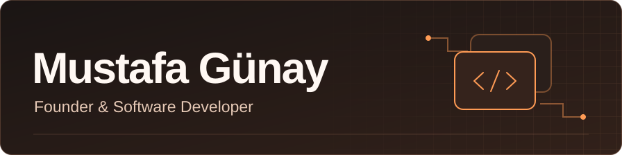

[Türkçe](https://github.com/Kaevros) · English

I'm a Management Information Systems student at the European University of Lefke and the founder of GNY Menu. I build web products and Windows desktop tools, and I'm interested in application security.

&nbsp;  &nbsp; 

## Technical skills

- **Web development** · TypeScript, React, Next.js, Tailwind CSS
- **Backend & cloud** · PostgreSQL, Supabase, Cloudflare Workers, D1, R2
- **Desktop development** · C#, .NET, WPF, Electron, Python (Tkinter)
- **Cybersecurity** · Web application security, authentication, authorization, PostgreSQL row-level security (RLS)

## Selected projects

### [Morf](https://github.com/Kaevros/morf-public)

An open-source Windows app with media controls, per-app volume, and a temporary file shelf in a compact panel at the edge of the screen. You can turn down a video playing in your browser while keeping your music app at the same volume.

`C#` · `.NET` · `WPF` · `Win32 & Core Audio` · `MIT`

### [bio.mustafagunay.com](https://bio.mustafagunay.com/)

A link-in-bio platform for bringing social accounts and custom links together on one personal page. When you update a link or profile image, you can see how it will look to visitors before publishing.

`JavaScript` · `Cloudflare Workers` · `D1` · `R2`

### [GNY Menu](https://gnymenu.com/?lang=en)

A multilingual QR menu and order management platform for restaurants, cafés, and hotels. Guests order from their tables, and staff track orders across waiter, kitchen, and cashier screens.

**QR table order → Kitchen display → Thermal receipt**

`Next.js` · `TypeScript` · `Supabase` · `Cloudflare Workers & R2`

### [GNY Print Station](https://gnymenu.com/cozumler?lang=en)

A Windows companion to GNY Menu that automatically sends kitchen tickets and cashier receipts to USB or Ethernet thermal printers. Kitchen tickets can go to the prep area while cashier receipts print at the counter. Staff can pair printers, run test prints, and track print jobs in the app.

`Electron` · `React` · `TypeScript` · `Vite`

### [Scientific Calculator](https://github.com/Kaevros/Python-Bilimsel-Hesap-Makinesi)

A Python and Tkinter desktop calculator with trigonometric, logarithmic, and exponential functions.
