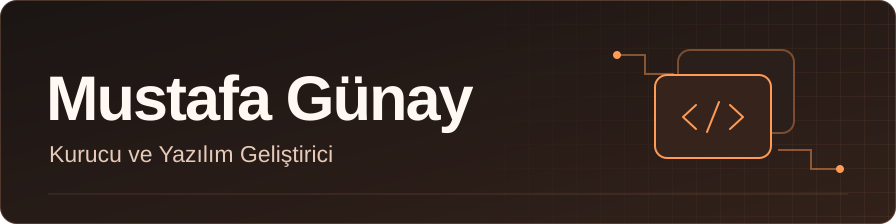

Türkçe · [English](https://github.com/Kaevros/Kaevros/blob/main/README.en.md)

Lefke Avrupa Üniversitesi'nde Yönetim Bilişim Sistemleri öğrencisiyim ve GNY Menü'nün kurucusuyum. Web ürünleri ve Windows masaüstü araçları geliştiriyorum. Uygulama güvenliğiyle de ilgileniyorum.

&nbsp;  &nbsp; 

## Teknik beceriler

- **Web geliştirme** · TypeScript, React, Next.js, Tailwind CSS
- **Sunucu ve bulut** · PostgreSQL, Supabase, Cloudflare Workers, D1, R2
- **Masaüstü geliştirme** · C#, .NET, WPF, Electron, Python (Tkinter)
- **Siber güvenlik** · Web uygulaması güvenliği, kimlik doğrulama, yetkilendirme, PostgreSQL satır düzeyinde güvenlik (RLS)

## Seçili projeler

### [Morf](https://github.com/Kaevros/morf-public)

Ekranın kenarındaki kompakt bir panelde medya kontrollerini, uygulama bazlı ses ayarlarını ve geçici bir dosya rafını bir araya getiren açık kaynaklı Windows uygulaması. Örneğin tarayıcıdaki videonun sesini kısarken müzik uygulamasının sesini aynı seviyede tutabilirsin.

`C#` · `.NET` · `WPF` · `Win32 ve Core Audio` · `MIT`

### [bio.mustafagunay.com](https://bio.mustafagunay.com/)

Sosyal hesaplarını ve özel bağlantılarını tek bir kişisel sayfada toplayabileceğin bir platform. Bir bağlantıyı ya da profil görselini değiştirdiğinde, ziyaretçilerin sayfayı nasıl göreceğini yayımlamadan önce önizleyebilirsin.

`JavaScript` · `Cloudflare Workers` · `D1` · `R2`

### [GNY Menü](https://gnymenu.com/)

Restoran, kafe ve oteller için çok dilli QR menü ve sipariş yönetimi platformu. Misafirler masadan sipariş verir. Ekip, siparişi garson, mutfak ve kasa ekranları üzerinden takip eder.

**QR menüden masa siparişi → Mutfak ekranı → Termal fiş**

`Next.js` · `TypeScript` · `Supabase` · `Cloudflare Workers ve R2`

### [GNY Print Station](https://gnymenu.com/cozumler)

GNY Menü'den gelen mutfak ve kasa fişlerini USB veya Ethernet bağlantılı termal yazıcılara otomatik gönderen Windows uygulaması. Örneğin mutfak fişlerini hazırlık alanındaki yazıcıya, kasa fişlerini kasadaki yazıcıya yönlendirebilirsin. Yazıcı eşleştirme, test çıktısı ve baskı takibi uygulama üzerinden yapılır.

`Electron` · `React` · `TypeScript` · `Vite`

### [Bilimsel Hesap Makinesi](https://github.com/Kaevros/Python-Bilimsel-Hesap-Makinesi)

Trigonometrik, logaritmik ve üstel işlemleri destekleyen Python ve Tkinter tabanlı masaüstü hesap makinesi.

<!--START_SECTION:waka-->
<!--END_SECTION:waka-->
