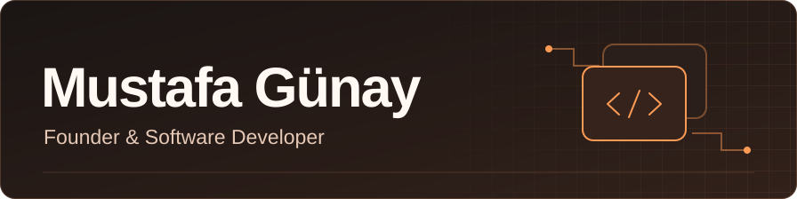

I build web and desktop applications and study Management Information Systems.

&nbsp;  &nbsp; 

## Technical skills

- **Web development** · TypeScript, React, Next.js, Tailwind CSS
- **Backend & cloud** · PostgreSQL, Supabase, Cloudflare Workers, D1, R2
- **Desktop development** · Electron, Python (Tkinter)
- **Cybersecurity** · Web security fundamentals, authentication, access control with row-level security (RLS)

## Selected work

### [GNY Menu](https://gnymenu.com/)

A web platform for restaurants, cafés, and hotels. Guests can browse menus and place orders, while staff manage service, kitchen tickets, checkout, and printing from connected screens.

`Next.js` · `React` · `TypeScript` · `Supabase` · `Cloudflare Workers & R2`

### GNY Print Station

A Windows desktop companion for GNY Menu that routes kitchen and cashier tickets to local USB and Ethernet thermal printers. It handles device pairing, test prints, and print job status.

`Electron` · `React` · `TypeScript` · `Vite`

### [Bio](https://bio.mustafagunay.com/)

A link-in-bio platform for publishing a personal page that brings your links together.

`Cloudflare Workers` · `D1` · `R2`

### [Scientific Calculator](https://github.com/Kaevros/Python-Bilimsel-Hesap-Makinesi)

A desktop calculator built with Python and Tkinter, with support for trigonometric, logarithmic, and exponential functions.

<!--START_SECTION:waka-->
<!--END_SECTION:waka-->
