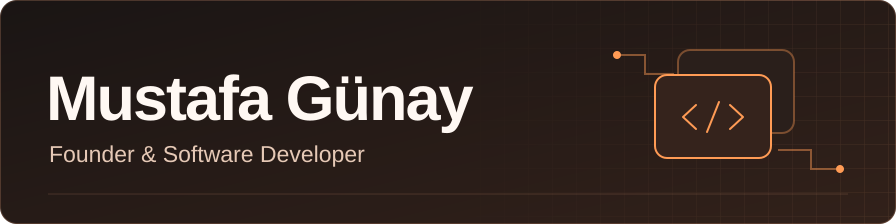

I'm a Management Information Systems student at the European University of Lefke and the founder of GNY Menu. I build full-stack web products and Windows desktop tools, with an interest in application security.

&nbsp;  &nbsp; 

## Technical skills

- **Web development** · TypeScript, React, Next.js, Tailwind CSS
- **Backend & cloud** · PostgreSQL, Supabase, Cloudflare Workers, D1, R2
- **Desktop development** · C#, .NET, WPF, Electron, Python (Tkinter)
- **Cybersecurity** · Web application security fundamentals, authentication, authorization, PostgreSQL row-level security (RLS)

## Selected projects

### [Morf](https://github.com/Kaevros/morf-public)

An open-source Windows utility that brings media controls, per-app volume and mute, and a temporary drag-and-drop file shelf into a compact panel at the edge of the screen.

`C#` · `.NET` · `WPF` · `Win32 & Core Audio` · `MIT`

### [bio.mustafagunay.com](https://bio.mustafagunay.com/)

A link-in-bio platform for creating a personal page with social accounts and custom links. An editor lets you update your profile and preview changes before publishing.

`JavaScript` · `Cloudflare Workers` · `D1` · `R2`

### [GNY Menu](https://gnymenu.com/)

A QR menu and operations platform for restaurants, cafés, and hotels. Guests can browse multilingual QR menus and order from their tables. Staff manage orders through connected waiter, kitchen, and cashier screens.

`Next.js` · `TypeScript` · `Supabase` · `Cloudflare Workers & R2`

### [GNY Print Station](https://gnymenu.com/cozumler?lang=en)

A Windows companion app for GNY Menu that automatically sends kitchen tickets and cashier receipts to USB or Ethernet thermal printers. Staff can pair the station, run test prints, and track print jobs.

`Electron` · `React` · `TypeScript` · `Vite`

### [Scientific Calculator](https://github.com/Kaevros/Python-Bilimsel-Hesap-Makinesi)

A Python and Tkinter desktop calculator with trigonometric, logarithmic, and exponential functions.

<!--START_SECTION:waka-->
<!--END_SECTION:waka-->
